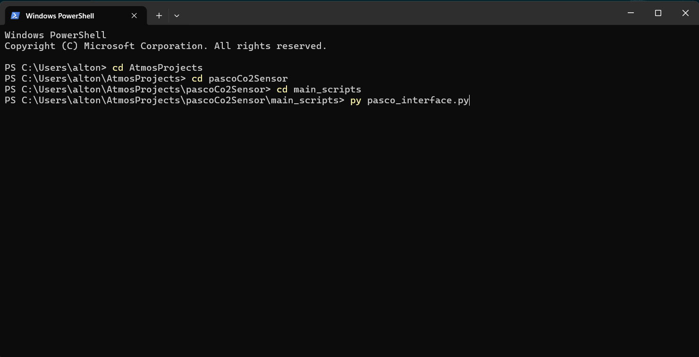
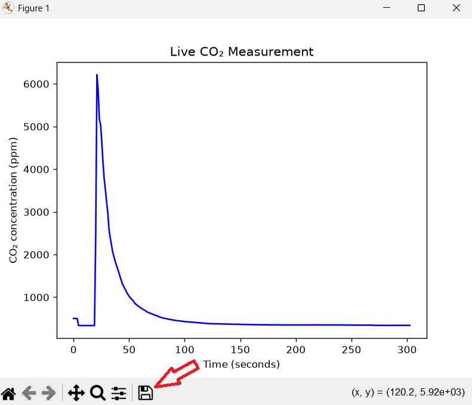

# Pasco Co2 Sensor

## How to use the python sensor interface.

1. Download the full pascoCo2Sensor repository.

2. Make sure python is downloaded on your machine. If it's not, you can get it from [here](https://www.python.org/downloads/).

3. Open your terminal and enter the commands below to install the necessary libraries.

---
| OS | Command1 | Command2 |
| -------- | -------- | -------- |
| Mac/Unix | python3 -m pip install matplotlib | python3 -m pip install pasco |
| Widnows | py -m pip install matplotlib | py -m pip install pasco |
---

4. Press the button on the Pasco Wireless CO2 sensor and make sure the bluetooth indicator light is blinking.

5. Run the pasco_interface.py file. You can do this by opening the file in an IDE like VSCode or by running it in a terminal. To run the file in the terminal, navigate to the main_scripts folder by using the **cd "file_name"** command. Then, run the command below.

---
| OS | Command |
| -------- | -------- |
| Mac/Unix | python3 pasco_interface.py |
| Widnows | py pasco_interface.py |
---

---

6. If you have done everything correctly, the sensor will now connect to your machine and start collecting data. A window will appear with a live plot of the data, and a CSV file will be saved into the output/data folder. The CSV file will be saved automatically. If you would like to save an image of the plot, press the save symbol in the bottom of the window.

---

---

7. When you are done collecting data, hit ctrl+c to stop the program.

8. Do science and have fun!!!
